<div align="center">

<a href="https://ai-atlas-lovat.vercel.app">
  
</a>

<br/>
<br/>

**See how you really use AI, across every tool, without giving away your conversations.**

AI Atlas brings ChatGPT, Claude, Gemini, DeepSeek, Kimi and seven more into one privacy-first dashboard,<br/>
introduced by a scroll-driven WebGL particle universe.

<br/>

[](https://ai-atlas-lovat.vercel.app)
[](https://nextjs.org)
[](https://react.dev)
[](https://threejs.org)
[](https://www.typescriptlang.org)
[](LICENSE)

[**Live demo**](https://ai-atlas-lovat.vercel.app) · [**Demo dashboard**](https://ai-atlas-lovat.vercel.app/dashboard?mode=demo) · [Quick start](#-quick-start) · [Architecture](docs/architecture.md) · [Security](docs/security.md)

<br/>

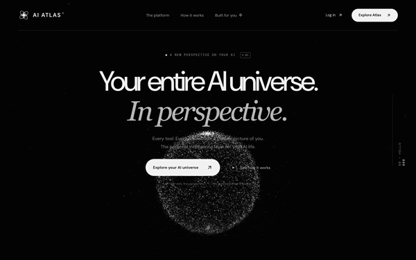

<sub>Real capture of the landing page. Scroll drives the whole sequence: <b>sphere → orbit → vortex → galaxy</b>.</sub>

</div>

<br/>

## ✨ Why AI Atlas

You probably use three or four AI tools a week. Each one has its own history, its own dashboard and no idea the others exist. Atlas gives you **one honest picture**.

- 🪐 **Every tool in one orbit.** ChatGPT, Claude, Gemini, Cursor, GitHub Copilot, Perplexity, DeepSeek, Kimi, Grok, Le Chat, Meta AI and Qwen, side by side with their real logos.
- 🔒 **Metadata, not messages.** Atlas keeps timestamps, tool, model and category. Your prompts and conversation text are never stored or sent to an outside classifier.
- 🧭 **Patterns you can act on.** Trends, work categories, your go-to tool and an *AI Fingerprint* that sums up how you work.
- 🧪 **Honest numbers only.** Demo data is clearly labelled, missing costs stay missing, and Atlas never invents "time saved".
- ⚡ **Try it in seconds.** The full demo dashboard and a browser-local workspace need no account and no API key.

<br/>

## 🎬 See it in action

<div align="center">

<a href="assets/demo.mp4">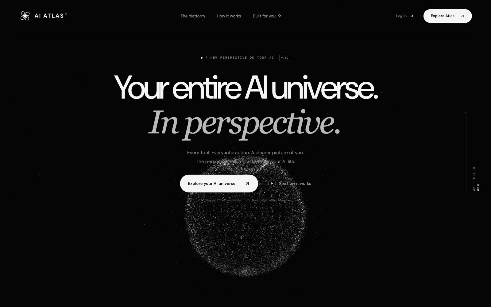</a>

<sub>▶ <a href="assets/demo.mp4"><b>Watch the full 36-second walkthrough</b></a> (MP4): landing, globe sequence, provider gallery and dashboard.</sub>

</div>

<!-- To get an inline video player on GitHub: drag assets/demo.mp4 into any issue or PR comment,
     copy the https://github.com/user-attachments/assets/... URL it gives you, and paste it on its own line here. -->

### The scroll story

<table>
  <tr>
    <td width="33%">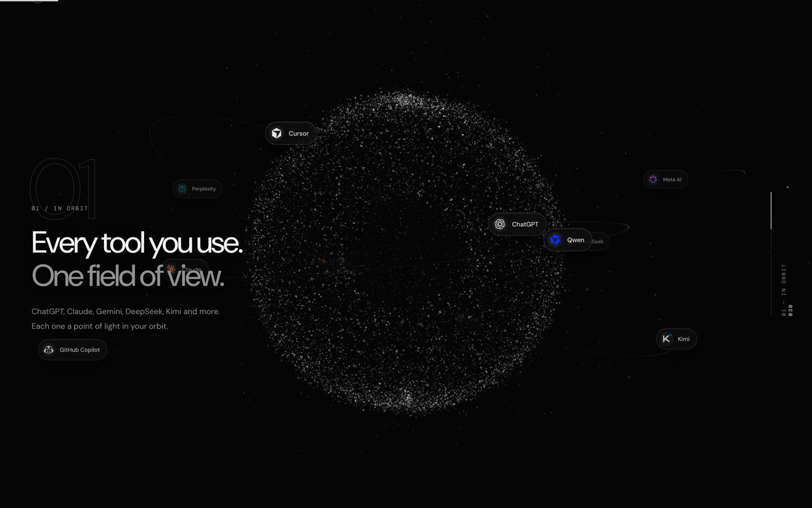</td>
    <td width="33%">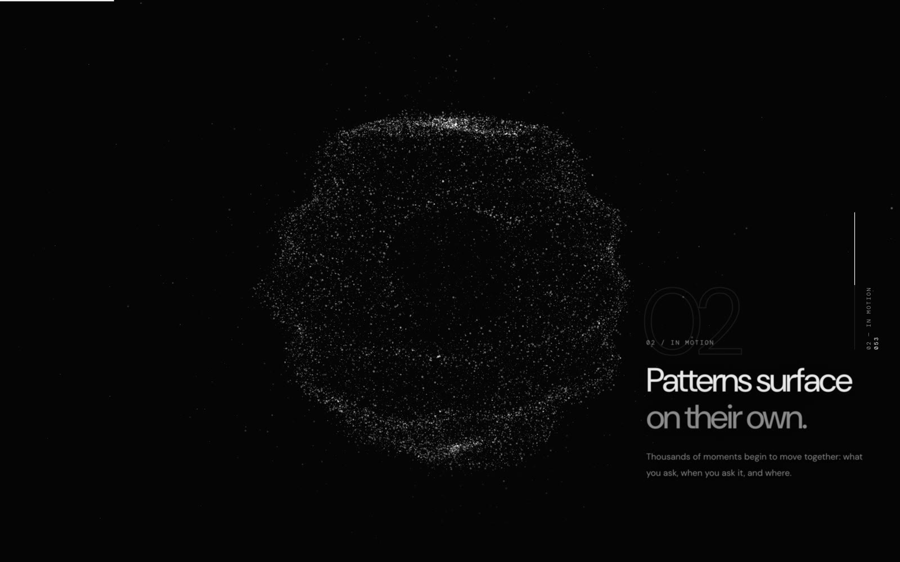</td>
    <td width="33%">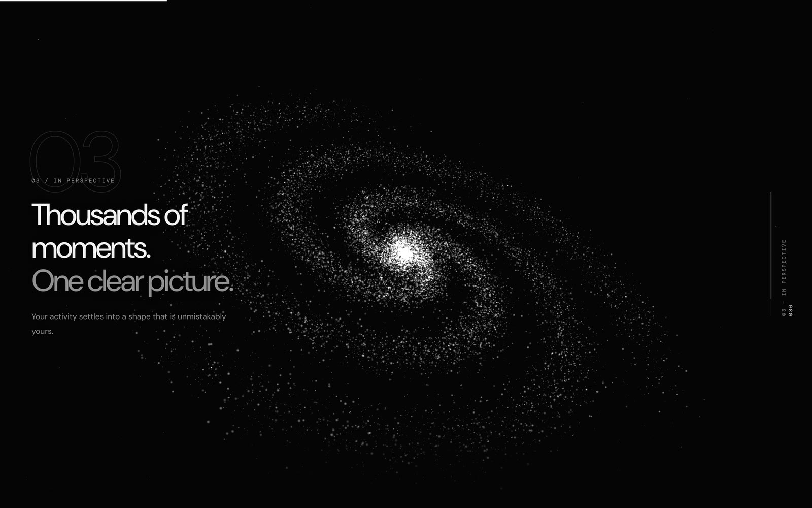</td>
  </tr>
  <tr>
    <td align="center"><b>01 · In orbit</b><br/><sub>Logos fly into orbit around ~26k GPU particles</sub></td>
    <td align="center"><b>02 · In motion</b><br/><sub>A noise-driven vortex ripples across the shell</sub></td>
    <td align="center"><b>03 · In perspective</b><br/><sub>Particles arc into a slowly turning spiral galaxy</sub></td>
  </tr>
</table>

### Twelve tools, finally side by side

<div align="center">
  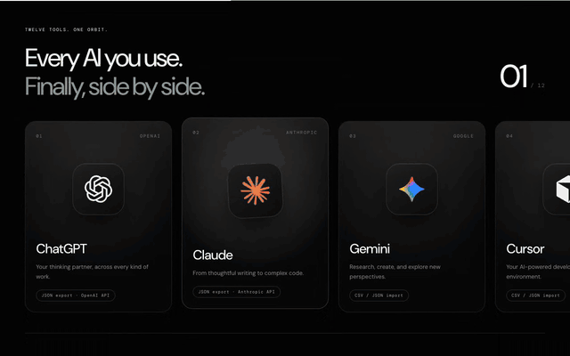
</div>

### The dashboard

<div align="center">
  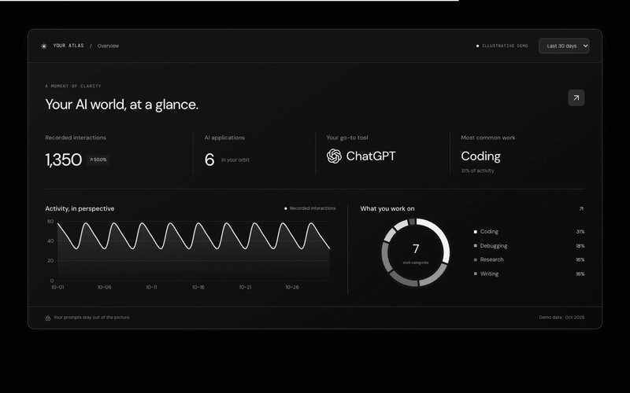
</div>

<br/>

<table>
  <tr>
    <td width="50%">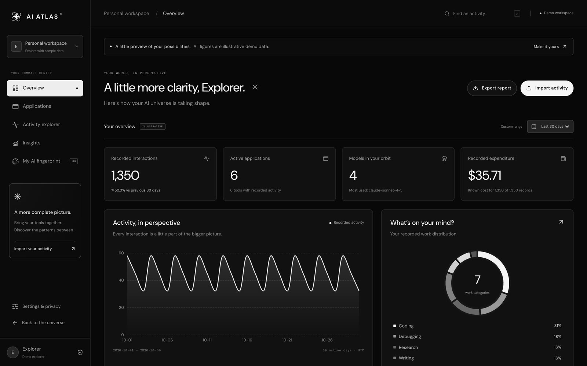</td>
    <td width="50%">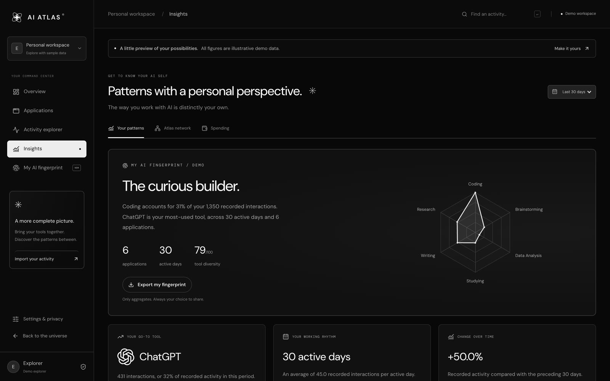</td>
  </tr>
  <tr>
    <td align="center"><b>Overview</b><br/><sub>Period filters, comparisons, trends and category mix</sub></td>
    <td align="center"><b>Insights & AI Fingerprint</b><br/><sub>A personal portrait of how you work with AI</sub></td>
  </tr>
  <tr>
    <td width="50%">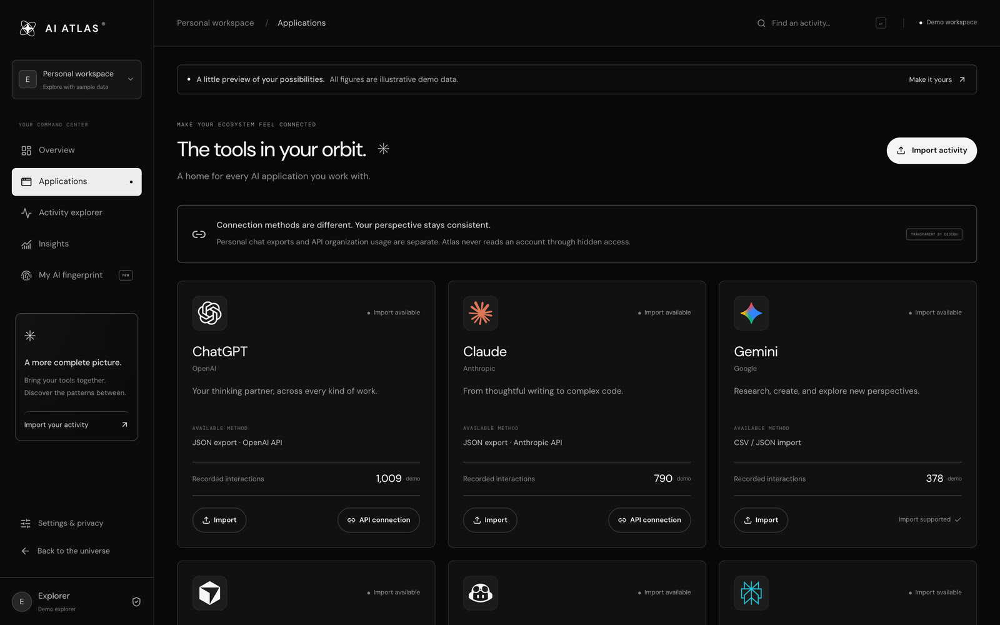</td>
    <td width="50%">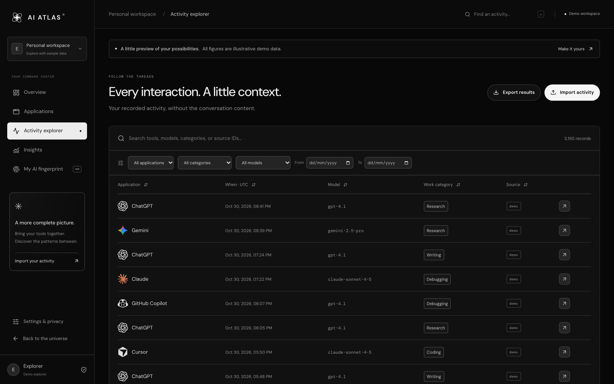</td>
  </tr>
  <tr>
    <td align="center"><b>Applications</b><br/><sub>Real status and import method for every tool</sub></td>
    <td align="center"><b>Activity explorer</b><br/><sub>Search, filter, sort and correct categories</sub></td>
  </tr>
</table>

### Built for your phone too

<div align="center">
  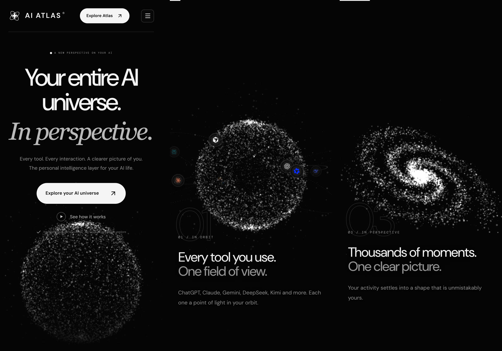
</div>

<br/>

## 🚀 Quick start

**Prerequisites:** Node.js **22.13+** and npm.

```bash
git clone https://github.com/satiricalguru/Ai-atlas.git
cd Ai-atlas
npm ci
npm run dev
```

Open **http://127.0.0.1:5173**, then try:

| URL | What you get |
|:--|:--|
| `/` | The landing page and particle universe |
| `/dashboard?mode=demo` | The full dashboard with clearly labelled sample data |
| `/dashboard?mode=local` | Your own imports, stored only in this browser |

> [!TIP]
> Neither the demo nor the local workspace needs an account, a database or an API key. Accounts and syncing switch on once you add the Supabase settings described below.

<details>
<summary><b>Other ways to run it</b></summary>

<br/>

`npm run dev` and `npm run build` use the bundled Vinext runtime, which builds a Cloudflare Worker. `npm run start` previews that build locally. For the standard Next.js runtime (what Vercel uses):

```bash
npm run dev:next
npm run build:next
npx next start
```

</details>

<br/>

## 📥 Bring your data

| Source | How it gets in |
|:--|:--|
| **ChatGPT** | Upload `conversations.json` from your data export, or connect an OpenAI organization admin key |
| **Claude** | Upload your conversation export JSON, or connect an Anthropic organization admin key |
| **Every other tool** | Import normalized CSV or JSON (example below) |

```csv
provider,timestamp,model,category,tokens,cost,external_id
chatgpt,2026-10-29T10:00:00Z,gpt-4.1,Writing,1250,0.012,example-1
claude,2026-10-29T11:30:00Z,claude-sonnet-4-5,Coding,2400,0.024,example-2
deepseek,2026-10-30T09:00:00Z,deepseek-chat,Research,,,example-3
```

Supported `provider` values: `chatgpt` · `claude` · `gemini` · `cursor` · `copilot` · `perplexity` · `deepseek` · `kimi` · `grok` · `mistral` · `meta` · `qwen` · `other`.

Imports are validated against a schema, deduplicated by source ID, and capped at 5 MB / 2,000 rows per upload.

<br/>

## 🧠 How it works

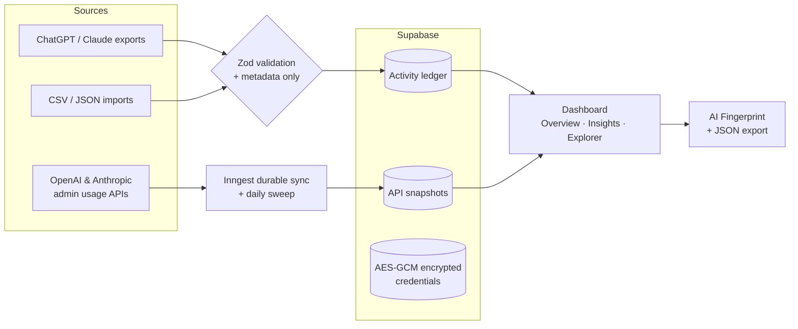

- **Frontend:** Next.js App Router, React 19, Tailwind CSS 4, Motion, ECharts and TanStack Table.
- **The universe:** React Three Fiber with custom GLSL. One `ShaderMaterial` animates about 26k points (11k on phones) with simplex-noise breathing, cursor repulsion, a scroll-driven vortex and a sphere-to-galaxy morph. Logo chips are projected from 3D each frame. Lenis provides the smooth scrolling.
- **Backend:** Supabase Auth and PostgreSQL with tenant row-level security, WebCrypto AES-GCM for provider keys, and Inngest for durable syncing.
- **Fallbacks:** the WebGL scene pauses when off-screen and drops to a static dotted sphere when the browser has reduced motion turned on or no WebGL 2.

<details>
<summary><b>Everything that's built</b></summary>

<br/>

- Original atlas logo, wordmark and favicon, self-hosted DM Sans / DM Mono, and a black-and-white design system.
- Landing narrative: particle universe, provider gallery, interactive dashboard preview, fingerprint, privacy, FAQ and final call to action.
- Email sign-up and sign-in, GitHub OAuth, PKCE callback, email recovery, password reset, server-protected account pages, session-refresh proxy and sign-out, all with Supabase Auth. Without configuration, the UI says accounts are unavailable.
- Four-step onboarding with provider choices, connection methods and consent to local classification.
- Overview with period and custom-range filters, previous-period comparison, provider ranking, category distribution, trends, recent activity and separately labelled API snapshots.
- Applications with real status, import methods, verified OpenAI/Anthropic organization credential workflows, encrypted key storage, queue/retry and disconnect.
- Activity explorer with search, date/provider/model/category filters, sorting, pagination, metadata details and correction history.
- Insights, AI Fingerprint and aggregate JSON export, a provider/category network, and cost-coverage and spending views.
- Profile, classification preference, data export, purging of activity and connections, session controls and account deletion.
- ChatGPT and Claude export adapters, stable IDs and deduplication. Prompts and conversation bodies are never stored.
- PostgreSQL migrations with tenant RLS, ownership constraints, atomic rate limits and inaccessible integration secrets. Inngest durable sync plus a daily 03:00 UTC sweep.

</details>

<br/>

## ⚙️ Configuration

Only needed for real accounts, server-side storage and API syncing.

<details>
<summary><b>Set up Supabase, encryption and Inngest</b></summary>

<br/>

1. Create a Supabase project and run every file in `supabase/migrations/` in order (SQL editor or your migration pipeline). They create no demo records.
2. Copy `.env.example` to `.env.local` and fill in `NEXT_PUBLIC_SUPABASE_URL` and `NEXT_PUBLIC_SUPABASE_PUBLISHABLE_KEY`. Both are browser-safe.
3. In Supabase Auth, enable email/password. Set your Site URL and allow the exact callback URLs, including `http://127.0.0.1:5173/auth/callback` and your deployed origin. Password recovery uses `/auth/callback?type=recovery`, then `/reset-password`. Keep email confirmation on and configure production SMTP.
4. Optionally enable GitHub OAuth in Supabase. The GitHub OAuth app's callback points to Supabase's auth callback, which then redirects back to Atlas. This only signs users in; it grants no Copilot analytics access.
5. Generate fresh database types from **your** deployed project with the Supabase CLI before you expand backend queries.
6. For key storage, syncing and account deletion, set the server-only `SUPABASE_SERVICE_ROLE_KEY`. Generate `INTEGRATION_ENCRYPTION_KEY` as 32 random bytes in 64 hex characters, and keep it stable while encrypted credentials exist.
7. Set `INNGEST_EVENT_KEY` and `INNGEST_SIGNING_KEY`, then register `/api/inngest` with Inngest. Production handlers fail closed without a signing key, and the endpoint must be reachable from Inngest.
8. Never prefix a secret with `NEXT_PUBLIC_`. Public values are inlined at build time, so build with the same public configuration you deploy.

| Variable | Exposure | Needed for |
|:--|:--|:--|
| `NEXT_PUBLIC_SUPABASE_URL` | Public | Accounts and database |
| `NEXT_PUBLIC_SUPABASE_PUBLISHABLE_KEY` | Public | Accounts and database |
| `SUPABASE_SERVICE_ROLE_KEY` | Server only | Encrypted keys, sync, account deletion |
| `INTEGRATION_ENCRYPTION_KEY` | Server only | Encrypting provider credentials |
| `INNGEST_EVENT_KEY` | Server only | Queuing and scheduling sync |
| `INNGEST_SIGNING_KEY` | Server only | Verifying workflow requests |
| `NEXT_PUBLIC_APP_URL` | Public, optional | Deployment tooling origin |

</details>

<details>
<summary><b>Integrations and honest limits</b></summary>

<br/>

- **Import adapters:** normalized CSV/JSON, plus selected ChatGPT `conversations.json` and Claude conversation JSON formats. ZIP archives and arbitrary report shapes are rejected. A conversation export adds one record per conversation, not a made-up count of messages.
- **Official API adapters:** OpenAI organization completion usage and Anthropic's documented organization messages usage report. They need genuine admin access and record bucketed token/request metadata separately from the activity ledger. Anthropic input tokens are *uncached* input tokens. Provider cost APIs and subscription billing are not implemented; cost stays empty unless you import it. These adapters have not been verified end to end against a live provider account.
- **Not available yet:** consumer chat-history OAuth, Gemini project/IAM reporting, Cursor Enterprise analytics, Copilot enterprise reports and Perplexity Analytics. See the [integration matrix](docs/integration-matrix.md).
- **Scale limits:** the account overview loads at most 20,000 recent events and 2,000 snapshots, with a visible warning. Importing the same activity from two different formats can double-count it, because cross-source reconciliation is not implemented.

</details>

<br/>

## 🧪 Testing

```bash
npm run typecheck   # strict TypeScript
npm test            # 37 unit, integration and security tests (Vitest + PGlite)
npm run test:e2e    # Playwright, desktop and mobile Chromium
npm run build       # production build
```

The suites cover parsing errors, metadata minimization, deduplication, formula-safe CSV, analytics, mocked provider requests and rate limits, encryption tampering, same-origin checks, body-size limits, and two-tenant row-level-security isolation on a real PostgreSQL engine.

> [!NOTE]
> Not yet verified: live Supabase email/OAuth delivery, real provider credential permissions, signed Inngest delivery, real-device mobile GPU performance, Safari/Firefox, and a production security audit. Treat this as a tested foundation, not an audited SaaS.

<br/>

## 📚 Docs

[Product research](docs/research.md) · [Integration matrix](docs/integration-matrix.md) · [Design decisions](docs/design-research.md) · [Architecture](docs/architecture.md) · [Threat model & security](docs/security.md) · [Roadmap](docs/roadmap.md)

## 🗺️ Roadmap

- [x] Particle-universe landing page with scroll storytelling
- [x] Twelve AI tools with real brand marks
- [x] ChatGPT and Claude export imports
- [x] OpenAI and Anthropic organization usage sync
- [ ] Server-side aggregation and search for very large histories
- [ ] Cross-source deduplication
- [ ] Live connectors for Gemini, Cursor, Copilot and Perplexity analytics

## 🤝 Contributing

Issues and pull requests are welcome. Please run `npm run typecheck` and `npm test` before opening a PR, and keep the privacy rule intact: **metadata in, conversation content never**.

## 📄 License

Code is released under the [MIT License](LICENSE).

AI product names and logos are trademarks of their respective owners and are used only to identify those products. Brand marks come from [Lobe Icons](https://github.com/lobehub/lobe-icons) (MIT). DM Sans and DM Mono are under the SIL Open Font License (see `public/fonts/`).

<br/>

<div align="center">

<sub>Made with curiosity by <a href="https://github.com/satiricalguru">Jatin Pandey</a> · If Atlas gave you a clearer picture, a ⭐ helps others find it.</sub>

<br/>

[↑ Back to top](#)

</div>
